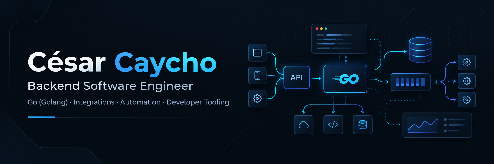
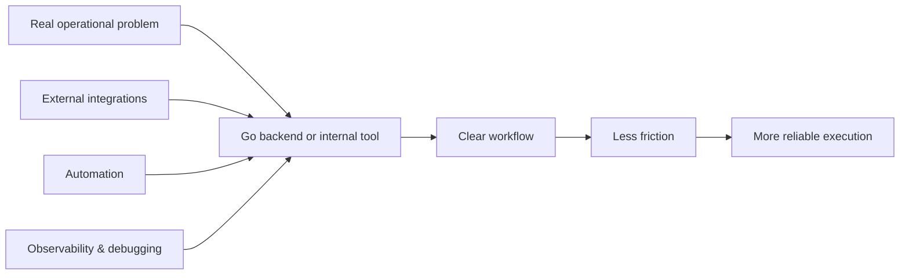

  

  <strong>Backend Software Engineer focused on Go, integrations, automation and developer tooling.</strong>

  I enjoy building backend systems that reduce operational friction, connect external services, and turn technical workflows into practical tools.

  <a href="https://github.com/cfabrica46?tab=repositories">
    <strong>Explore Projects</strong>
  </a>
  &nbsp;&nbsp;·&nbsp;&nbsp;
  <a href="https://www.linkedin.com/in/cfabrica46/">
    LinkedIn
  </a>
  &nbsp;&nbsp;·&nbsp;&nbsp;
  <a href="mailto:cfabrica46@gmail.com">
    Email
  </a>

---

## About me

- Backend Software Engineer with strong focus on **Go (Golang)**.
- Experienced in **microservices, integrations, internal tooling, debugging and operational support**.
- Comfortable working on systems that involve **APIs, concurrency, data flows, observability and real-world constraints**.
- I use **Python** as a secondary stack for automation, scripting and problem-solving.
- I'm especially interested in building software that is **useful, maintainable and clear to reason about**.

---

## What I work best on

| Area | What I enjoy building |
|---|---|
| **Backend Engineering** | Services, APIs, orchestration flows, business logic, maintainable Go code |
| **Integrations** | External providers, middleware flows, validation, transformation and operational resilience |
| **Tooling & Automation** | Internal tools, support utilities, QA helpers, scripts and developer workflows |
| **Concurrency & Performance** | Controlled concurrency, worker pools, execution strategies, benchmarks and trade-offs |
| **Debugging & Operations** | Investigation tools, log analysis, issue isolation and production-oriented troubleshooting |

---

## Professional focus

---

## Featured projects

### [Go Concurrency Benchmarks](https://github.com/cfabrica46/go-concurrency-benchmarks)

A focused Go engineering lab comparing sequential execution, unbounded goroutines, bounded `errgroup`, and worker pools through **simulated I/O workloads**.

**Highlights**
- Reproducible concurrency experiments
- Benchmarks and functional testing
- Trade-off analysis
- Clear documentation of methodology and limitations

### [Verification Desk](https://github.com/cfabrica46/verification-desk-demo)

A lightweight desktop demo built with **Go + Wails** that turns a technical lookup workflow into a simple experience for non-technical users using fully synthetic data.

**Highlights**
- Desktop tooling with Go
- Separation between UI, service layer and data store
- Offline, synthetic-data demo
- Practical UX for a technical workflow

---

## Tech stack

### Primary

  
  
  
  
  

### Technologies I work with

  
  
  
  
  
  
  
  
  

---

## Current focus

- Strengthening my public GitHub around **Go backend engineering**.
- Building a portfolio that reflects **real engineering judgment**, not filler projects.
- Deepening work around **concurrency, integrations, tooling and maintainable backend design**.
- Open to opportunities aligned with **Backend Software Engineer / Go Engineer / Integration Engineer**.

---

## A few things that define my work

- I like turning **messy operational tasks into clearer tools**.
- I care about **trade-offs**, not just making something work.
- I enjoy systems that sit between **business logic and technical reality**: integrations, failures, constraints, debugging and maintainability.
- I prefer projects that are **useful, understandable and honest about their scope**.

---

## Contact

- GitHub: [@cfabrica46](https://github.com/cfabrica46)
- LinkedIn: [linkedin.com/in/cfabrica46](https://www.linkedin.com/in/cfabrica46/)
- Email: [cfabrica46@gmail.com](mailto:cfabrica46@gmail.com)
